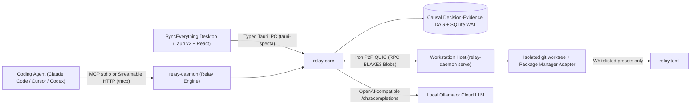

# SyncEverything

**Cross-device compute relay & causal state companion for coding agents (Claude Code, Cursor, Codex, and any MCP client), powered by the Relay engine.**

SyncEverything lets you code on a lightweight laptop while delegating builds, tests, and GPU experiments to your workstation over encrypted peer-to-peer QUIC—keeping every decision, Git revision, and run result synchronized in a deterministic causal graph so your coding agent never hallucinates outdated metrics or pollutes your main working tree.

> **Naming:** **SyncEverything** is the user-facing product and desktop workbench. Internally, it is powered by the **Relay** Rust engine (`relay-core`, `relay-daemon`, `relay-desktop`), exposes the `relay-daemon` CLI/MCP server, and reads project task whitelists from `relay.toml`.

---

## Architecture



---

## Core Mechanisms

- **`iroh` P2P QUIC & BLAKE3 Sync**: A single `iroh` 1.5 endpoint handles direct LAN connections, NAT-traversing relay fallback, air-gapped `--lan-only` pairing, and single-machine `--local-only` loopback testing. Commits travel as exact Git bundles alongside tracked working-tree diffs, incremental DAG deltas, and BLAKE3-addressed execution logs, with a persistent SQLite outbox for offline resilience.
- **Causal Decision-Evidence DAG with Deterministic `STALE` Quarantine**: Links `Decision` notes (rationale and constraints), `Artifact` revisions (Git commit SHA and environment fingerprint), and `Evidence` runs (metrics and log blob hashes). Whenever an `Artifact` is updated or superseded, `DagEngine` deterministically traverses downstream dependencies and marks affected `Evidence` as `STALE` (`Outdated`), redacting stale metrics at the MCP boundary and blocking stale log reads so agents treat the DAG as the sole metric source of truth.
- **Isolated `git worktree` Self-Healing & Human-in-the-Loop Approval**: Task preflights and repairs run inside per-task Git worktrees so the user's main checkout stays untouched. Failed preflights capture `stderr_tail`, `detected_missing_module`, and ±10-line `error_snippets`. Agents inspect worktree files via `read_worktree_file`, propose dependency fixes (`dependency_spec`) or atomic search-and-replace/overwrite edits (`code_diff`) with automatic rollback if smoke verification fails, and pause at a dual-mode approval gate (native MCP Elicitation or SyncEverything Desktop Diff Approval) before running the target preset.
- **Extensible Package Manager Adapter Layer**: SyncEverything auto-detects project toolchains (`pyproject.toml` with `uv`, `Cargo.toml` with `cargo`, `package.json` with `bun`/`pnpm`/`yarn`/`npm`, or generic Git) to generate starter `relay.toml` manifests. Today it provides deep Python/`uv` environment fingerprinting and offline dependency repair alongside preset-based execution for any toolchain declared in `relay.toml`, designed to extend cleanly to additional runtime and container adapters.

---

## 3-Minute Quick Start

### Prerequisites

- **Rust** `1.94+` (edition 2024) and **Git**
- **Bun** `1.3+` (for the Tauri v2 desktop workbench)
- **`uv`** and **Python `3.11+`** (for Python worktree preflights and examples)
- **Optional:** [Ollama](https://ollama.com) (`ollama pull qwen3.5:4b`) or any OpenAI-compatible API for built-in self-healing diagnosis

### 1. Build the Relay daemon

```bash
cargo build --release -p relay-daemon
```

### 2. Launch SyncEverything Desktop

```bash
cd crates/relay-desktop
bun install --frozen-lockfile
bun run tauri dev
```

On first launch, SyncEverything starts in **Local Test (`LocalDualSandbox`)** mode—spawning isolated Laptop and Workstation endpoints over loopback `iroh` on a single machine. Open any local Git repository (if it lacks a `relay.toml`, click **Generate relay.toml**), or switch roles to pair a laptop with a remote workstation using a one-time pairing code.

### 3. Connect a Coding Agent over MCP

Start a headless Workstation Host (prints a pairing ticket and serves Streamable HTTP MCP at `http://127.0.0.1:7608/mcp`):

```bash
cargo run -p relay-daemon -- --repo-root . serve
```

Or register `relay-daemon mcp-stdio` in Claude Code, Cursor, or Codex CLI (you can also copy a ready-to-paste snippet from **Workspace & AI Settings -> MCP** in SyncEverything Desktop, or start from [`prompts/mcp-clients/`](prompts/mcp-clients/)):

```json
{
  "mcpServers": {
    "relay": {
      "command": "relay-daemon",
      "args": ["--repo-root", "/path/to/your/repo", "--data-dir", "/path/to/your/repo/.relay", "mcp-stdio"]
    }
  }
}
```

---

## Examples

- **PyTorch CUDA / MPS / CPU Demo ([`examples/pytorch-cuda-demo/`](examples/pytorch-cuda-demo/))**: A seeded 4-class spiral MLP training and evaluation project with automatic accelerator selection (`CUDA -> MPS -> CPU`), structured JSON metrics captured into the DAG, and [`smoke` / `train` / `eval` presets](examples/pytorch-cuda-demo/relay.toml) ready for two-machine LAN compute relay.
- **Self-Hosted Workspace ([`relay.toml`](relay.toml))**: This repository ships a root `relay.toml` with `check`, `test_core`, and `test` Cargo presets so you can immediately open the SyncEverything repository itself as a live workspace and run tasks through the Relay engine.

---

## Repository Layout

```text
.
├── Cargo.toml                 # Rust workspace (relay-core, relay-daemon, relay-desktop)
├── relay.toml                 # Self-hosted task preset whitelist for this repository
├── crates/
│   ├── relay-core/            # Shared contracts, DAG engine, SQLite WAL, iroh P2P, rmcp MCP, worktree sandbox, agent loop
│   ├── relay-daemon/          # Headless Host/Client daemon, MCP stdio/HTTP server, doctor & sync CLI
│   └── relay-desktop/         # Tauri v2 + React 19 + shadcn/ui + React Flow desktop workbench
├── docs/                      # Architecture, contracts, development guide, design spec, roadmap
├── examples/                  # Ready-to-run example workspaces (e.g., PyTorch CUDA demo)
├── prompts/                   # Edge/Host system prompts, routing policy, and MCP client config templates
└── course/                    # Archived research proposal, planning, benchmarks, Chaos Suite, and eval harness
```

---

## Security & Trust Boundaries

SyncEverything enforces strict execution boundaries by design:

- **No arbitrary shell execution**: The Host executes only named presets declared in the target repository's `relay.toml`, validating parameter keys against `allowed_params` and invoking executables directly without shell interpolation.
- **Worktree isolation vs. OS privilege scope**: Preflights, candidate patches, and runs execute inside isolated Git worktrees (with strict path/symlink confinement on `read_worktree_file`), leaving the main checkout untouched. Task processes still run under the Host OS user account—only expose trusted repositories and reviewed `relay.toml` manifests.
- **Authenticated P2P & human approval**: `iroh` encrypts and authenticates peer links with Ed25519 `NodeId` keys and BLAKE3 content hashes; self-healing patches require explicit human approval before executing.

See [`SECURITY.md`](SECURITY.md) for the full threat model, peer trust/revocation guidance, and vulnerability reporting instructions.

---

## Contributing & Documentation

- [Development Guide](docs/development.md) — Local setup, daemon commands, and verification gates
- [Architecture](docs/architecture.md) — Component boundaries, runtime modes, and sync flow
- [Interface Contracts](docs/contracts.md) — MCP tools, DAG types, `relay.toml`, and wire protocol
- [Product Roadmap](docs/product-roadmap.md) — Shipped v0.1 capabilities and upcoming milestones
- [Contributing Guide](CONTRIBUTING.md) — Workflow, Conventional Commits, and PR checklist

## License

Licensed under the [MIT License](LICENSE).
