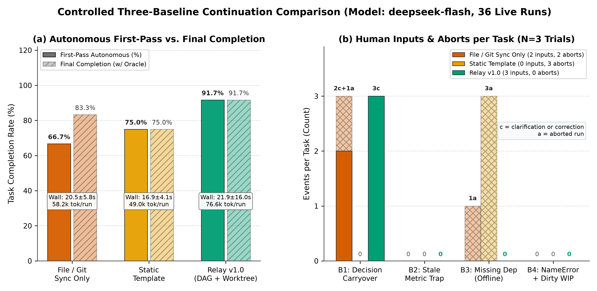

# Relay v1.0 — Track 5 Experimental Evaluation Report

> **Post-optimization provenance (`feat/agent-tool-ergonomics`, `scoring_version: 3`, 2026-11-25).**
> The results committed in `8f682ae` were collected against the upgraded `relay-daemon` (`file_edits` + `read_worktree_file` + `PreflightReport.error_snippets` + mandatory stale visibility & `metric_authority_note` + Ollama XML-500 retry + configurable local `no-think`). The recorded dataset contains the following observations.
> - **Exp 1**: 36/36 live runs, 0 HTTP errors, 0 turn-budget violations (`llm_turns ≤ 12` whenever `corrections == 0`).
> - **Exp 2**: 54/54 live queries, 0 errors, 54/54 `context_bundle_hash` match `context_ablation_scaling.csv`, 54/54 `inputs_sha256` match SHA-256 of `context_ablation_inputs.json`.
> - **Exp 3**: 15/15 live runs in `scoring_version: 3` cohort (`N = 3` per model config), 0.0% stale hallucination across all 5 configs.
> - **Exp 4**: 8/8 Scripted (+P2P loopback gate PASS) with 9/9 MCP tools covered, plus 3 × 8 live LLM chaos runs.

> Consolidated quantitative evaluation across four empirical suites using live `relay-daemon` (`iroh` 1.5, `rmcp` 3.11, SQLite WAL, `petgraph` DAG, `git worktree` + `uv` offline sandbox).

---

## Experimental Setup & Reproducibility Invariants

- **Workstation Hardware & Runtimes**: Windows 11 host with NVIDIA GeForce RTX 5060 Laptop GPU (8 GB VRAM), 32 GB system RAM, Rust `edition = "2024"` workspace (`target/debug/relay-daemon.exe`), Python 3.14 via `uv 0.12.19`, and local Ollama `0.40.16`.
- **LLM Endpoints Evaluated**:
  - **Cloud API**: `deepseek-flash` via OpenAI-compatible `/chat/completions` (`https://api.deepseek.com`).
  - **Local Quantized Weights (Zero-Copy 16K Context Aliases)**: `relay-qwen3.5-4b-16k` (3.3 GB Q4_K_M, `100% GPU` at `num_ctx=16384`) and `relay-qwen3.5-9b-16k` (6.6 GB Q4_K_M, `16%/84% CPU/GPU` split on 8 GB VRAM), evaluated strictly sequentially with `ollama stop` between 4B/9B switches. Exp 2 and Exp 4 evaluate local models under Relay's default `reasoning_effort = "none"` (`no-think`) edge profile; Exp 3 evaluates both `no-think` and default thinking modes.
- **Offline Determinism & Strict Anti-Hallucination Scoring**:
  - All sandbox executions lock `UV_OFFLINE=1`, `UV_NO_CONFIG=1`, `UV_PYTHON_DOWNLOADS=never`, LF line endings, and clean `git worktree` isolation against [bench/fixture-repo](../fixture-repo).
  - **Strict Stale-Evidence Rule** (unified across Experiments 2, 3, and 4): an answer passes a stale-evidence trap *only* if it both acknowledges staleness/invalidation AND withholds quarantined stale metric numbers (e.g., `2.16502` / `2.82267` and rounded forms) from its response. Mere disclaimer prose alongside repeated stale numbers fails.

---

## Experiment 1 — Controlled Three-Baseline Continuation Comparison (Fig 1)

Using `deepseek-flash` across **4 standardized cross-device continuation tasks × 3 independent trials (36 live runs total)** on identical [fixture-repo](../fixture-repo) checkouts (`bench/results/run_baseline_comparison.py`):
- `B1_decision_carryover`: Non-default off-repo session parameter decision (`alpha = 0.25`, `windows = 7,14,28`, offline `UV_OFFLINE=1`).
- `B2_stale_metric_trap`: Commit 2 changes `src/forecast.py` blend to `0.4*MA + 0.6*EWMA` while `results/calibration-latest.txt` and frozen `HANDOFF.md` still hold Commit 1's `2.16502`.
- `B3_missing_dep_heal`: Laptop commits `import tiny_stats` without lockfile update; offline `./vendor/tiny_stats-0.1.0-py3-none-any.whl` repair required without dirtying `main`.
- `B4_defect_dirty_tree`: Commit introduces `NameError: DEFAULT_ALPHA` while user holds uncommitted WIP notes in `main` `README.md`.

### Aggregate Results (`N = 12` Runs per Baseline)

| Architecture | First-Pass Autonomous | Final Completion | Manual Corrections | Unrecovered Aborts | UI Safety Gate | Wall Time (Mean ± SD) | Avg Tokens |
|---|---:|---:|---:|---:|---:|---:|---:|
| **`file_sync_only`** | 66.7% (8/12) | 83.3% (10/12) | 2 (`B1`) | 2 (`1 B1`, `1 B3`) | 0.0 / run | 20.47 ± 5.83 s | 58,159 |
| **`static_template`** (`HANDOFF.md`) | 75.0% (9/12) | 75.0% (9/12) | 0 | 3 (`3 B3`) | 0.0 / run | **16.88 ± 4.13 s** | **48,961** |
| **`relay_v1`** (`mcp-stdio`) | **91.7% (11/12)** | **91.7% (11/12)** | 3 (`t1 B1`) | **0** | 1.0 / run | 21.92 ± 15.98 s | 76,581 |

*Per-task completion breakdown (`First-Pass / Final`, `N = 3` trials each)*:
- **`file_sync_only`**: `B1` 0.0% / 66.7%, `B2` 100.0% / 100.0%, `B3` 66.7% / 66.7%, `B4` 100.0% / 100.0%.
- **`static_template`**: `B1` 100.0% / 100.0%, `B2` 100.0% / 100.0%, `B3` **0.0% / 0.0%**, `B4` 100.0% / 100.0%.
- **`relay_v1`**: `B1` 66.7% / 66.7%, `B2` **100.0% / 100.0%**, `B3` **100.0% / 100.0%**, `B4` **100.0% / 100.0%** (0.0% first-pass stale hallucination, 100.0% main working tree preserved).

### Human-Wait Sensitivity Model

$$T_{\text{eff}}(t_h) = T_{\text{wall}} + N_{\text{suppl}} \cdot t_h + N_{\text{approve}} \cdot 5\text{s}$$

| Architecture | $t_h = 0\text{s}$ | $t_h = 15\text{s}$ | $t_h = 30\text{s}$ | $t_h = 60\text{s}$ | Notes |
|---|---:|---:|---:|---:|---|
| **`file_sync_only`** | 20.47 ± 5.83 s | 22.97 ± 10.03 s | 25.47 ± 15.34 s | 30.47 ± 26.64 s | Includes 2 unrecovered loop aborts (`B1`, `B3`) |
| **`static_template`** | 16.88 ± 4.13 s | 16.88 ± 4.13 s | 16.88 ± 4.13 s | 16.88 ± 4.13 s | Includes 3 unrecovered `B3` aborts (0/3 pass on `B3`) |
| **`relay_v1`** | 26.92 ± 15.98 s | 30.67 ± 28.68 s | 34.42 ± 41.56 s | 41.92 ± 67.44 s | Includes `+5s` UI diff approval; all 3 corrections came from single `t1 B1` terminal-`Failed` outlier (other 11/12 runs: `17.5 s` wall, `0` corrections) |

**Key Takeaways**:
- **Highest autonomous completion & zero loop aborts**: `relay_v1` achieved **91.7% first-pass & 91.7% final completion** with **0 loop aborts** (vs. **66.7% / 83.3%** with 2 aborts on `file_sync_only` and **75.0% / 75.0%** with 3 aborts on `static_template`).
- **Offline dependency healing (`B3`) & defect isolation (`B4`)**: Under strict 12-turn budgets, `static_template` passed `B3_missing_dep_heal` on **0/3 trials** (repeated shell command loops / turn exhaustion) and `file_sync_only` passed `B1` on **0/3 first-pass trials** (missing off-repo `alpha = 0.25` constraint). `relay_v1` passed `B2`, `B3`, and `B4` **9/9 (100%)** on the first pass with zero manual corrections while preserving `main` `README.md` WIP bytes cleanly across all 12 runs.
- **Fail-closed FSM honesty on `t1 B1`**: On `relay_v1`'s single failure (`t1 B1`), the task entered terminal `Failed` state during initial execution; Relay's FSM strictly rejected `Failed -> PreflightRunning` re-entry, and the agent refused across all 3 Oracle correction turns to fabricate unverified metrics without a fresh DAG evidence node. Excluding that single outlier, the 11 passing `relay_v1` trials averaged **17.5 s** wall time with **0** manual corrections.

---

## Experiment 2 — Deterministic Context Representation Ablation (Fig 2)

### Part A — Deterministic Scaling & Quarantine (`relay-daemon compose-context --all-strategies --no-sync`)

Across 5 progressive SQLite DAG checkpoints (`depth_1`, `depth_3`, `depth_6`, `depth_10`, and mixed `depth_mixed_6` with 5 stale + 1 fresh evidence node), repeated `compose-context` runs verified **100% `blake3` hash determinism** (`blake3_determinism_verified: true`) and **54/54 hash identity** between `context_ablation_scaling.csv`, `context_ablation_inputs.json`, and `context_ablation_runs.jsonl`:

| Snapshot | Rounds (Fresh / Stale) | `full_transcript` Tokens | `flat_summary` Tokens | `dag_bundle` Tokens | Token Savings (`dag` vs `full`) | Exposed Stale Metrics (`full` / `flat` / `dag`) |
|---|---|---:|---:|---:|---:|---|
| `depth_1` | 1 (0 / 1) | 797 | 177 | 213 | -73.3% | `1 / 1 / 0` |
| `depth_3` | 3 (0 / 3) | 2,068 | 417 | 530 | -74.4% | `3 / 3 / 0` |
| `depth_6` | 6 (0 / 6) | 3,974 | 777 | 1,004 | -74.7% | `6 / 6 / 0` |
| `depth_10` | 10 (0 / 10) | 6,517 | 1,259 | **1,638** | **-74.9%** | `10 / 10 / 0` |
| `depth_mixed_6` | 6 (1 / 5) | 3,811 | 758 | 1,042 | -72.7% | `5 / 5 / 0` |

### Part B — Empirical Hallucination Matrix (54 Live Runs Across 3 Models × 3 Strategies × 6 Queries)

| Model | Strategy | Stale Hallucination Rate | Direct Stale Metric Citations | Query Pass Rate (`Q1–Q6`) | Mixed Fresh-vs-Stale (`Q5`) Accurate | Constraints Recalled (`Q6`) | Median Latency (ms) |
|---|---|---:|---:|---:|---|---|---:|
| `deepseek-flash` | `full_transcript` | 33.3% (2/6) | 2/6 (33.3%) | 66.7% | Yes | Yes | 2,470.3 |
| `deepseek-flash` | `flat_summary` | 33.3% (2/6) | 1/6 (16.7%) | 66.7% | **No** | Yes | 2,751.7 |
| `deepseek-flash` | **`dag_bundle`** | **0.0% (0/6)** | **0/6** | **100.0%** | **Yes** | **Yes** | **1,933.6** |
| `qwen3.5:4b (no-think)` | `full_transcript` | 50.0% (3/6) | 2/6 (33.3%) | 50.0% | **No** | Yes | 3,341.4 |
| `qwen3.5:4b (no-think)` | `flat_summary` | **83.3% (5/6)** | 4/6 (66.7%) | 16.7% | **No** | Yes | 2,266.0 |
| `qwen3.5:4b (no-think)` | **`dag_bundle`** | **0.0% (0/6)** | **0/6** | **100.0%** | **Yes** | **Yes** | **2,558.1** |
| `qwen3.5:9b (no-think)` | `full_transcript` | 33.3% (2/6) | 2/6 (33.3%) | 66.7% | Yes | Yes | 11,043.6 |
| `qwen3.5:9b (no-think)` | `flat_summary` | **83.3% (5/6)** | 4/6 (66.7%) | 16.7% | **No** | Yes | 5,736.1 |
| `qwen3.5:9b (no-think)` | **`dag_bundle`** | **0.0% (0/6)** | **0/6** | **100.0%** | **Yes** | **Yes** | **5,551.8** |

**Key Takeaways**:
- **Physical quarantine eliminates stale hallucination completely**: Across all **18 live `dag_bundle` queries** on Cloud, 4B, and 9B, Relay achieved **0.0% stale hallucination**, **0 direct stale citations**, **100.0% query pass rate (`Q1–Q6`)**, and **100% mixed fresh-vs-stale accuracy (`Q5`)** while cutting depth-10 context size by **74.9%** (`6,517 → 1,638` tokens).
- **Unstructured compression fails catastrophically on edge models**: Stripping freshness metadata and causal edges (`flat_summary`) triggers **83.3% stale hallucination** (only 1/6 pass) on both `qwen3.5:4b (no-think)` and `qwen3.5:9b (no-think)` and **33.3%** even on cloud `deepseek-flash`; raw `full_transcript` still leaks stale numbers in **33.3%–50.0%** of queries.
- With local reasoning effort set to `none`, median DAG query latency was 2.56 s on 4B and 5.55 s on 9B. Different saved prompts, contexts and software were used in the earlier runs.

---

## Experiment 3 — Local Quantized (4B / 9B) vs. Cloud API Pareto Analysis (Fig 3)

Evaluated in [eval/models/benchmark-report.md](../../eval/models/benchmark-report.md) across **N = 3 independent trials** per configuration (**15 live MCP runs**, `scoring_version: 3`, live `relay-daemon mcp-stdio` with 9 MCP tools):

| Model Config | Endpoint | N | Pass Rate (Mean ± SD) | Tool Recall (Mean ± SD) | Stale Hallucination (Mean ± SD) | Loop Abort | S4 smoke-verified proposal | Median Latency ms (Mean ± SD) | Avg Tokens |
|---|---|---:|---:|---:|---:|---:|---|---:|---:|
| **`deepseek-flash`** | Cloud API | 3 | **100.0% ± 0.0%** | **1.000 ± 0.000** | **0.0% ± 0.0%** | **0.0% ± 0.0%** | **3/3 (100.0%)** | **3,953.2 ± 333.4** | **49,324** |
| **`qwen3.5:4b`** | Local Ollama | 3 | **100.0% ± 0.0%** | **1.000 ± 0.000** | **0.0% ± 0.0%** | **0.0% ± 0.0%** | **3/3 (100.0%)** | 11,922.6 ± 316.8 | 60,083 |
| **`qwen3.5:9b (no-think)`** | Local Ollama | 3 | **100.0% ± 0.0%** | **1.000 ± 0.000** | **0.0% ± 0.0%** | **0.0% ± 0.0%** | **3/3 (100.0%)** | 13,290.1 ± 2,238.1 | 59,640 |
| `qwen3.5:4b (no-think)` | Local Ollama | 3 | 83.3% ± 14.4% | 0.945 ± 0.048 | **0.0% ± 0.0%** | 16.7% ± 14.4% | 1/3 (33.3%) | **4,816.5 ± 171.0** | 58,636 |
| `qwen3.5:9b` | Local Ollama | 3 | 83.3% ± 14.4% | 0.972 ± 0.048 | **0.0% ± 0.0%** | 16.7% ± 14.4% | 2/3 (66.7%) | 25,076.8 ± 1,904.4 | 77,753 |

**Key Takeaways**:
- **Zero stale hallucination across all 15 runs**: The v3 scorer recorded **0.0% ± 0.0%** on the S2 trap for each model configuration (Cloud, 4B, and 9B, thinking and `no-think`).
- In the archived v3 runs, `qwen3.5:9b (no-think)` and `qwen3.5:4b` matched the observed cloud pass count of 12/12 and reached the S4 approval gate in all three trials. Their median latencies were 13.29 s and 11.92 s, compared with 3.95 s for `deepseek-flash`.
- **Clear Pareto frontier for edge routing**:
  - `qwen3.5:4b (no-think)` delivers near-cloud latency (**4.82 s** vs. **3.95 s**) with **83.3%** pass rate and **0.0%** stale leakage for interactive status/env/stale triage.
  - Across the three v3 trials per configuration, `qwen3.5:9b (no-think)` passed 12/12 scenarios with a 13.29 s median latency. Thinking mode passed 10/12 with a 25.08 s median latency.

---

## Experiment 4 — Chaos Suite 8-Fault Self-Healing Breakdown (Fig 4)

The table shows the archived Track 4 scorer’s outcomes. The scripted run’s P2P gate completed in 5,271.7 ms with a 35 ms RTT. [Archived runs](../chaos-cases/results)

| Runner | Pass Rate | Self-Heal (`C01,C03,C05,C06`) | Tool Recall | Tool errors on repair cases (`uv` + `file_edits`) | Stale Leaks (`C02,C07`) | Reported Tokens | Median LLM Latency (ms) |
|---|---:|---:|---:|---:|---:|---:|---:|
| **Scripted (+P2P Loopback)** | **8/8 (100.0%)** | **4/4 (100.0%)** | **1.000** | 0 | **0** | — | — |
| **`deepseek-flash` (Cloud)** | **8/8 (100.0%)** | **4/4 (100.0%)** | **1.000** | 2 (`0 + 2`)* | **0** | 363,970 | **10,524.0** |
| **`qwen3.5:4b` (Local no-think)** | **7/8 (87.5%)** | **4/4 (100.0%)** | 0.906 | 4 (`0 + 4`)* | **0** | **231,087** | 22,493.0 |
| **`qwen3.5:9b` (Local no-think)** | 6/8 (75.0%) | **4/4 (100.0%)** | 0.906 | 12 (`0 + 12`) | **0** | 250,426 | 50,246.1 |

*\*Note: The repair-case error column counts tool/helper errors and unverified proposals on (`C01`, `C03`, `C05`, `C06`); total retries across all 8 cases were `3` on `deepseek-flash` (+1 on `C07`), `6` on `qwen3.5:4b` (+2 on `C04`), and `12` on `qwen3.5:9b`.*

**Key Takeaways**:
- The historical judge assigned 4/4 self-heals to each model. For C03, it inferred a heal from a completed task. The revised judge reads the smoke-verified proposal explicitly. The two stale-trap cases recorded zero leaks for all three models.
- **Remaining edge failure modes are workflow-gating, not patch syntax**: `qwen3.5:4b (no-think)` passed **7/8 (87.5%)** — including all four repair cases — failing only `C04` (repeated identical `approve_and_execute_task` call after reconnect). `qwen3.5:9b (no-think)` passed **6/8 (75.0%)** and smoke-verified both `C05` and `C06` patches, halting only at the final approval-confirmation turn (`C05` yielded to human approval text without re-calling `approved_via_ui=true`; `C06` exhausted the 14-turn cap right after `approval_required`).

---

## Historical cohorts and attribution

The pre-upgrade Track 3 archive contains 15 unversioned v1 runs. Commit `76c8705` contains these results and a v2 scorer, but no live v2 results. Commit `8f682ae` adds 15 live v3 runs. Both groups have three runs per configuration. The prompts, scoring rules, tool interfaces, retry policy, and model settings changed together. These groups describe two deployments and do not isolate the effect of any one change.

| Model | Passed S4 scenarios, v1 → v3 | S2 responses flagged by each cohort’s scorer, v1 → v3 |
|---|---:|---:|
| DeepSeek Flash | 2/3 → 3/3 | 1/3 → 0/3 |
| Qwen 4B | 0/3 → 3/3 | 2/3 → 0/3 |
| Qwen 4B (no-think) | 0/3 → 1/3 | 2/3 → 0/3 |
| Qwen 9B | 0/3 → 1/3 | 3/3 → 0/3 |
| Qwen 9B (no-think) | 0/3 → 3/3 | 3/3 → 0/3 |

Each row uses three S2 opportunities. The original JSON summaries divided S2 flags by all 12 scenario attempts per model. Qwen 9B had two smoke-verified S4 proposals in v3 and passed the complete S4 approval-gate scenario once.

The archived Track 4 local case pass counts changed from 3/8 to 7/8 (4B) and 3/8 to 6/8 (9B). DeepSeek passed 8/8 in both suites. The earlier reports are available from Git at `76c8705:bench/chaos-cases/results/`. The current local runs use reasoning effort `none`. Track 4 counts repeated tool/helper errors and unverified proposals under “retries”. The historical artifacts do not identify how many failures were patch-format errors or HTTP retries.

### Validation for the release

- Run the five Track 3 configurations three times with scorer v4. This scorer rejects model-supplied approval before execution, requires the gate to identify the verified proposal, and measures stale leakage per S2 opportunity. Figure 3 and the model matrix above use the archived v3 cohort. The raw files lack approval-call arguments and complete tool replies for retrospective v4 scoring.
- Repeat Track 4 C03 for each model to verify the recorded patch passed smoke and applied to the clean index before testing the dirty checkout. Run the complete eight-case suite for release-level aggregate results.
- Keep Exp 2 frozen bundles and the input SHA-256 together for any targeted retry. Provider-reported token counts cover successful responses. LLM latency includes HTTP waiting and retries, excludes local tool execution, and is distinct from Exp 1 wall time.
- To estimate a component’s effect, run matched trials with the same fixture, scorer, prompts, endpoint model and reasoning settings, changing only that component.

---

## Raw Artifact Index

- Baseline comparison logs: [baseline_comparison_runs.jsonl](./baseline_comparison_runs.jsonl), [baseline_comparison_summary.json](./baseline_comparison_summary.json), [baseline_comparison_summary.csv](./baseline_comparison_summary.csv)
- Context ablation logs & frozen inputs: [context_ablation_inputs.json](./context_ablation_inputs.json), [context_ablation_scaling.csv](./context_ablation_scaling.csv), [context_ablation_runs.jsonl](./context_ablation_runs.jsonl), [context_ablation_summary.json](./context_ablation_summary.json)
- Track 3 N=3 matrix (`scoring_version: 3`): [eval/models/benchmark-report.md](../../eval/models/benchmark-report.md), [eval/models/results/](../../eval/models/results/)
- Track 4 Chaos logs: [bench/chaos-cases/results/](../chaos-cases/results/)
- Figures (300 DPI PNG + vector SVG + PDF): [figures/](./figures/) (`fig1_baseline_comparison`, `fig2_context_ablation`, `fig3_model_pareto`, `fig4_chaos_self_healing`)
