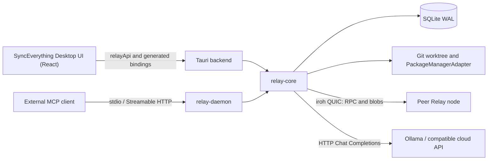

# SyncEverything Architecture (Relay Engine)

SyncEverything (powered by the Relay engine) hands off work tied to a Git commit from a Client to a Host. It records decisions, code revisions, and experiment results in a shared causal graph so that users and coding agents can tell which results still apply after the code changes.

## Components

Both the desktop app and the headless daemon use `relay-core`. The desktop backend embeds the engine and uses the same MCP handlers for worktree operations. The daemon exposes those handlers to external MCP clients (Claude Code, Cursor, Codex, and others).

| Component | Responsibility |
| --- | --- |
| [`relay-core`](../crates/relay-core/src/) | Owns the shared contracts, causal DAG engine, SQLite persistence, peer protocols, worktree sandbox, MCP tool handlers, and model client. |
| [`relay-daemon`](../crates/relay-daemon/src/main.rs) | Provides headless Host startup, stdio and Streamable HTTP MCP, repository initialization (`init`), repository health checks (`doctor`), context composition, and a two-node loopback check. |
| [Tauri backend](../crates/relay-desktop/src-tauri/src/) | Manages desktop runtime modes, pairing, peer refresh, task orchestration, built-in agent streaming, Tauri commands, and UI events. Its Specta builder defines the generated TypeScript interface. |
| [Desktop frontend](../crates/relay-desktop/src/) | Renders the React Flow causal graph, task queue, built-in agent rail, and approval drawer. React Query refreshes workspace data after typed Tauri events. The Vite browser preview uses mock state through the same API wrapper. |

## Runtime modes

| Mode | Where work happens |
| --- | --- |
| `Client` | The desktop pairs with a Host using its pairing ticket. It forwards task and approval requests and refreshes the Host's graph and task state. While the Host is unreachable, the Client persists pending requests in its outbox for replay. |
| `Host` | The desktop starts a peer endpoint and can run tasks when it has a configured Git checkout. The daemon's `serve` command starts a headless Host endpoint and the HTTP MCP server. MCP clients use the preflight, proposal, and execution tools to drive the headless workflow. |
| `LocalDualSandbox` | The desktop creates Client and Host endpoints on one machine using `NetworkProfile::LocalOnly`, with separate blob stores and a shared desktop engine. Task and approval requests still cross the loopback RPC boundary. The daemon's `sandbox-dual` check uses separate engines and data directories for the two nodes. |

Desktop Host and Client modes keep the standard `iroh` endpoint available for direct LAN connections when relay discovery times out. If standard endpoint startup fails, the desktop tries `LanOnly` with the same role's blob directory. This profile advertises direct IPv4 and available IPv6 addresses, with public relay discovery, relay routing, and gateway port mapping disabled. `LocalOnly` binds to loopback for single-machine testing. Each endpoint registers the content-addressed blob protocol and the `b"relay/rpc/1"` ALPN for length-prefixed JSON RPC. RPC carries task and approval requests, DAG snapshots and deltas, and sync metadata.

Each sync bundle transfers the selected Git commit and its history. On receipt, the Host imports the bundle into a private Git ref. A separate, optional blob contains the tracked-file changes captured by `git diff --binary HEAD`, including staged additions. The Host stores that diff by hash. Task worktrees start at the requested commit, and an approved task-specific patch can modify what runs. Untracked files remain on the originating device. The untracked-file archive described in the [wire protocol contract](contracts.md#4-wire-protocol-contract-iroh-15-single-endpoint-contractswire) is planned on the roadmap.

Runs executed on a P2P-enabled Host publish their log under the BLAKE3 hash recorded in Evidence. A paired Client fetches the blob on its first log read and caches it locally. The freshness check runs again before returning the requested lines. Earlier logs and runs executed by standalone MCP sessions remain available on the machine that recorded them.

## Decisions, code, and results

- `Decision` stores rationale and constraints. `Artifact` identifies a Git revision and environment fingerprint. `Evidence` links a task and preset to its metrics and log hash.
- `DagEngine` validates graph edges and walks downstream dependencies when an `Artifact` is updated or superseded. It marks affected `Evidence` as `Stale` and records the cause and reason. Agent context omits stale metrics, and MCP evidence reads reject stale results.
- `RelayEngine` coordinates graph and task changes with [`RelayStore`](../crates/relay-core/src/storage.rs). SQLite in WAL mode persists the graph, tasks and proposals, task log references (`task_log_refs`), handoffs, logs, trusted peers (`trusted_peers`), and outbox. Stable UUIDv7 task IDs make repeated submissions idempotent.

The graph and transition rules are implemented in [`dag.rs`](../crates/relay-core/src/dag.rs), [`engine.rs`](../crates/relay-core/src/engine.rs), and [`state.rs`](../crates/relay-core/src/state.rs).

## Task execution and approval

1. A `TaskSpec` names a repository, a base commit, a command preset, parameters, and whether approval is required.
2. The Host opens a task-specific Git worktree at the requested commit and runs the configured smoke preflight. The executor checks the selected preset against the Host checkout's `relay.toml`, accepts only allowed parameters, passes arguments directly to the configured executable, and enforces the preset timeout.
3. If preflight fails, the desktop can ask the model client to diagnose the failure. MCP clients can also inspect worktree files via `read_worktree_file` and submit a candidate dependency change (`dependency_spec`) or atomic edit (`code_diff`). A fix is recorded as a proposal only after smoke preflight passes with it applied inside the worktree; failed candidates roll back cleanly.
4. When approval is required, desktop users review the diff in the approval drawer. The MCP tool uses native elicitation when available and can return `ApprovalRequired` for a UI decision. Before running the preset, the executor checks the base commit and any approved diff. A successful run records metrics and logs as Evidence.

Worktrees isolate checkout and environment changes. Task processes run with the Host account's permissions, so the Host must trust the repository and its presets. For the handler and executor, see [`mcp.rs`](../crates/relay-core/src/mcp.rs) and [`sandbox/execution.rs`](../crates/relay-core/src/sandbox/execution.rs).

### Model interface

[`LlmClient`](../crates/relay-core/src/agent.rs) sends OpenAI-compatible `/chat/completions` requests with `reqwest`. The shared client takes a base URL, a model name, an optional reasoning effort setting, and an optional API key or environment variable name. The desktop's built-in diagnosis defaults to local Ollama. The model proposes changes; worktree verification and the approval flow control what executes.

## Extending with a New PackageManagerAdapter

The sandbox package-manager layer lives under [`crates/relay-core/src/sandbox/pm/`](../crates/relay-core/src/sandbox/pm/) and decouples preset generation (L1), environment fingerprinting & dependency diffing (L2), and structured dependency self-healing (L3) from the core engine, MCP server, and desktop UI.

Built-in adapters are registered in [`PackageManagerRegistry::builtin`](../crates/relay-core/src/sandbox/pm/mod.rs) in deterministic priority order:

1. `uv` (`python`, priority `10`) — `pyproject.toml` + `uv.lock`
2. `cargo` (`rust`, priority `20`) — `Cargo.toml` + `Cargo.lock`
3. `bun` / `pnpm` / `yarn` / `npm` (`javascript`, priorities `30`–`33`) — `package.json` + lockfile sub-detection
4. `generic` (`generic`, priority `1000`) — fallback `git` smoke preset; directs `dependency_spec` requests to `code_diff`

Repositories can pin an explicit adapter via `[project].package_manager = "<name>"` in `relay.toml`, or leave it unset for automatic priority detection.

### Adding a new ecosystem (e.g., `poetry`, `conda`, `go`, `dotnet`, or `vcpkg`)

Adding a new package manager requires **zero changes** to `RelayEngine`, `RelayMcpServer`, `SelfHealingAgent`, or the desktop UI:

1. **Create a module** in `crates/relay-core/src/sandbox/pm/<name>.rs` implementing [`PackageManagerAdapter`](../crates/relay-core/src/sandbox/pm/mod.rs):
   - `name()`, `ecosystem()`, `priority()`, and `detect(repo_root)` (e.g., `poetry.lock` / `[tool.poetry]` for `poetry`, `environment.yml` for `conda`, `go.mod` for `go`, `*.csproj` for `dotnet`, `vcpkg.json` for `vcpkg`).
   - **L1 (`generate_presets`)**: return a safe `smoke_preset` and whitelisted starter presets invoking the tool directly with explicit argv (never shell strings).
   - **L2 (`manifest_files`, `lockfile_paths`, `parse_dependencies`)**: declare the manifest and lockfile paths so `compute_fingerprint` automatically emits `<pm>:blake3:<16hex>`, and parse declared/locked dependencies for `check_env_diff`.
   - **L3 (`supports_dependency_add`, `add_dependency`)**: validate `spec` through centralized helpers in [`pm/security.rs`](../crates/relay-core/src/sandbox/pm/security.rs) (`reject_common_injection`, `ensure_regular_or_absent`, and `is_safe_cmd_arg` / Windows launcher safety), invoke the CLI with script-safe explicit argv via `tokio::process::Command`, and finish with `security::stage_intent_to_add(self.name(), worktree_path, self.lockfile_paths())` so newly created lockfiles appear in human approval diffs.
2. **Register the adapter** in `PackageManagerRegistry::builtin()` in [`crates/relay-core/src/sandbox/pm/mod.rs`](../crates/relay-core/src/sandbox/pm/mod.rs) (and add its file-presence rule in `detect_from_file_presence` if detection depends on lockfile disambiguation).
3. **Add unit tests** in `crates/relay-core/src/sandbox/pm/tests.rs` covering detection priority, explicit `package_manager` override, L1 manifest generation, L2 fingerprinting/diffing, and L3 input-injection / symlink rejection.

## Repository layout

| Area | Directory |
| --- | --- |
| Core engine, daemon, and Tauri backend | [`crates/relay-core/`](../crates/relay-core/), [`crates/relay-daemon/`](../crates/relay-daemon/), [`crates/relay-desktop/src-tauri/`](../crates/relay-desktop/src-tauri/) |
| React desktop UI, bindings, and localization | [`crates/relay-desktop/src/`](../crates/relay-desktop/src/) |
| Agent prompts and MCP client templates | [`prompts/`](../prompts/) |
| Example workspaces | [`examples/`](../examples/) |
| Documentation | [`docs/`](./) |
| Archived research, benchmarks, and evaluation suite | [`course/`](../course/README.md) |

Review the [interface contracts](contracts.md), the [Rust contract types](../crates/relay-core/src/contracts/), and the [frontend design spec](frontend-design-spec.md) before changing shared MCP tools, DAG and task types, wire RPC messages, or the `relay.toml` manifest format.
