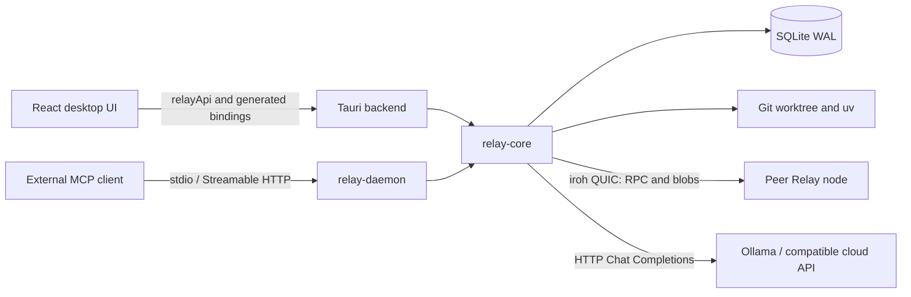

# Relay architecture

Relay hands off work tied to a Git commit from a Client to a Host. It records decisions, code revisions, and experiment results in a shared graph so that users and agents can tell which results still apply after the code changes.

## Components

Both the desktop and the daemon use `relay-core`. The desktop backend embeds the engine and uses the same MCP handlers for worktree operations. The daemon exposes those handlers to external MCP clients.

| Component | Responsibility |
| --- | --- |
| [`relay-core`](../crates/relay-core/src/) | Owns the shared contracts, graph and task rules, SQLite persistence, peer protocols, worktree operations, MCP tool handlers, and model client. |
| [`relay-daemon`](../crates/relay-daemon/src/main.rs) | Provides headless Host startup, stdio and Streamable HTTP MCP, and a two-node loopback check. |
| [Tauri backend](../crates/relay-desktop/src-tauri/src/) | Manages desktop runtime modes, pairing, peer refresh, task orchestration, Tauri commands, and UI events. Its Specta builder defines the generated TypeScript interface. |
| [Desktop frontend](../crates/relay-desktop/src/) | Renders the React Flow graph, task queue, and approval drawer. React Query refreshes workspace data after typed Tauri events. The Vite browser preview uses mock state through the same API wrapper. |

## Runtime modes

| Mode | Where work happens |
| --- | --- |
| `Client` | The desktop pairs with a Host using its pairing ticket. It forwards task and approval requests and refreshes the Host’s graph and task state. While the Host is unreachable, the Client persists pending requests in its outbox for replay. |
| `Host` | The desktop starts a peer endpoint and can run tasks when it has a configured Git checkout. The daemon’s `serve` command starts a headless Host endpoint and the HTTP MCP server. MCP clients use the preflight, proposal, and execution tools to drive the headless workflow. |
| `LocalDualSandbox` | The desktop creates Client and Host endpoints on one machine using `NetworkProfile::LocalOnly`, with separate blob stores and a shared desktop engine. Task and approval requests still cross the loopback RPC boundary. The daemon’s `sandbox-dual` check uses separate engines and data directories for the two nodes. |

For desktop Host and Client modes, Relay tries the standard iroh profile first and falls back to `LocalOnly` if the endpoint cannot come online. `LocalOnly` binds to loopback and disables relays. On each node, a single iroh endpoint registers both the content-addressed blob protocol and the `b"relay/rpc/1"` ALPN for length-prefixed JSON RPC. RPC carries task and approval requests, DAG snapshots and deltas, and sync metadata. Blob transfer carries Git bundles and optional working-tree diffs by hash.

## Decisions, code, and results

- `Decision` stores rationale and constraints. `Artifact` identifies a Git revision and Python environment fingerprint. `Evidence` links a task and preset to its metrics and log hash.
- `DagEngine` validates graph edges and walks downstream dependencies when an Artifact is updated or superseded. It marks affected Evidence as `Stale` and records the cause and reason. Agent context omits stale metrics, and MCP evidence reads reject stale results.
- `RelayEngine` coordinates graph and task changes with [`RelayStore`](../crates/relay-core/src/storage.rs). SQLite in WAL mode persists the graph, tasks and proposals, handoffs, logs, and outbox. Stable UUIDv7 task IDs make repeated submissions idempotent.

The graph and transition rules are implemented in [`dag.rs`](../crates/relay-core/src/dag.rs), [`engine.rs`](../crates/relay-core/src/engine.rs), and [`state.rs`](../crates/relay-core/src/state.rs).

## Task execution and approval

1. A `TaskSpec` names a repository, a base commit, a command preset, parameters, and whether approval is required.
2. The Host opens a task-specific Git worktree at the requested commit and runs the configured smoke preflight. The executor checks the selected preset against the Host checkout’s `relay.toml`, accepts only allowed parameters, passes arguments directly to the configured executable, and enforces the preset timeout.
3. If preflight fails, the desktop can ask the model client to diagnose the failure. MCP clients can also submit a candidate dependency change or code diff. A fix is recorded as a proposal only after smoke preflight passes with it applied inside the worktree.
4. When approval is required, desktop users review it in the approval drawer. The MCP tool uses native elicitation when available and can return `ApprovalRequired` for a UI decision. Before running the preset, the executor checks the base commit and any approved diff. A successful run records metrics and logs as Evidence.

Worktrees isolate checkout and environment changes. Task processes run with the Host account’s permissions, so the Host must trust the repository and its presets. For the handler and executor, see [`mcp.rs`](../crates/relay-core/src/mcp.rs) and [`sandbox/execution.rs`](../crates/relay-core/src/sandbox/execution.rs).

### Model interface

[`LlmClient`](../crates/relay-core/src/agent.rs) sends OpenAI-compatible `/chat/completions` requests with `reqwest`. The shared client takes a base URL, a model name, and an optional environment variable name for credentials. The desktop’s built-in diagnosis uses the local Ollama default. The model proposes changes. Worktree verification and the approval flow control what executes.

## Repository ownership

| Track | Owns |
| --- | --- |
| 1 | Core engine, daemon, and Tauri backend in [`crates/relay-core/`](../crates/relay-core/), [`crates/relay-daemon/`](../crates/relay-daemon/), and [`crates/relay-desktop/src-tauri/`](../crates/relay-desktop/src-tauri/). |
| 2 | React desktop, generated binding consumers, and localization in [`crates/relay-desktop/src/`](../crates/relay-desktop/src/). |
| 3 | Agent prompts, standard MCP client setup (Claude Code / Cursor / Codex / `dsh`), and model evaluation in [`prompts/`](../prompts/) and [`eval/models/`](../eval/models/). |
| 4 | Forecasting fixture and Chaos Suite cases in [`bench/fixture-repo/`](../bench/fixture-repo/) and [`bench/chaos-cases/`](../bench/chaos-cases/). |
| 5 | Baseline and ablation runs, raw data, and publication plots in [`bench/results/`](../bench/results/). |
| 6 | Windows and macOS QA, demo assets, report, and slides in [`docs/`](./) and [`demo/`](../demo/). |

Coordinate across tracks before changing the frozen MCP tools, DAG and task types, wire RPC, ChaosCase schema, or `relay.toml` format. Review the [interface contracts](contracts.md), the [Rust contract types](../crates/relay-core/src/contracts/), and the [frontend design spec](frontend-design-spec.md) for changes that reach the desktop.

## Frozen project documents

- [Project plan v2](relay_plan_v2.md) is the group’s internal plan.
- [Project proposal v2](relay_proposal_v2.md) is the proposal for the course instructor.
